# MyGL - AI 上下文文档（根级）

## 变更记录 (Changelog)

| 版本 | 日期 | 说明 |
|------|------|------|
| v1.2 | 2026-03-15 | 修复5处 bug（MatrixWrapper::Pop、MakeLookAt、Math::Mod、IsPowerOf2、GetRowVector）；跨平台兼容修复（Exception、setiosflags）；新增 CMake+GoogleTest 测试框架（77个测试，100%通过） |
| v1.1 | 2026-03-15 | 全量重新扫描，更新架构总览，新增模块级 CLAUDE.md 文件 |
| v1.0 | 2026-03-15 | 初始化生成，全量扫描 |

---

## 项目愿景

MyGL 是一个基于 C++ 的**纯软件渲染管线模拟器**，不依赖 GPU 硬件加速，完整地在 CPU 上实现了 OpenGL 风格的渲染流水线。项目的主要目标是**学习与理解 3D 图形编程的底层原理**，参考书目为《3D Graphics for Game Programming》（Jung Hyun Han 著）。

项目通过 SFML 作为窗口系统与图像 I/O 后端，将软件渲染结果输出到屏幕。已实现的效果包括：多边形渲染、纹理贴图（含 Mipmap）、纹理过滤与环绕模式、Alpha 混合、Phong 光照（点光源/平行光/聚光灯）、以及球体/立方体网格渲染。

---

## 架构总览

MyGL 采用单体仓库结构，无子包管理，核心代码位于 `MyGL/` 目录下，分三层组织：

```
MyGL/
  MyGL.h                     <- 公共头文件汇聚入口（统一导出 Core/Context/Extension）
  Core/                      <- 渲染核心层（GL 状态机、光栅化、着色、裁剪、数学）
  Context/                   <- 渲染上下文层（窗口抽象接口 + SFML 适配器实现）
  Extension/                 <- 扩展层（Mesh 网格数据容器 + 内置几何体工厂）
SFML/                        <- 第三方库（只读，头文件 + 预编译库）
Images/                      <- 测试用纹理资源（.bmp / .jpg）
Screenshots/                 <- 历史渲染效果截图（参考基准）
```

渲染流水线顺序（完全在 CPU 执行）：

```
顶点输入 (GL::AddVertex / GL::DrawArrays / GL::DrawElements)
  -> 模型-世界空间变换 (ModelView 矩阵)
  -> 投影变换 (Projection 矩阵)
  -> 视锥裁剪 (Clipping::ViewFrustumClipping)
  -> 背面剔除 (Clipping::BackFaceCulling)
  -> 视口变换 (Viewport 矩阵)
  -> 图元组装 (Primitives / DrawCall)
  -> 光栅化 (Rasterizer -> Fragment，含透视正确纹理坐标插值)
  -> 深度测试 (GL::DepthTest)
  -> 着色 (Shader::FragmentFunc / Phong Shading)
  -> Alpha 混合 (GL::_DoAlphaBlend)
  -> 写入颜色缓冲 (ColorBuffer)
  -> 呈现到窗口 (SFMLContext::FlushWindow)
```

---

## 模块结构图

```mermaid
graph TD
    ROOT["(根) MyGL 项目"] --> CORE["MyGL/Core"]
    ROOT --> CTX["MyGL/Context"]
    ROOT --> EXT["MyGL/Extension"]

    CORE --> CORE_STRUCT["Core/Structures\n(Vector2/3/4, Matrix3/4, Color, Buffer)"]
    CORE --> CORE_IFACE["Core/Interfaces\n(IClonable, IStringify)"]
    CORE --> CORE_GL["GL\n(单例状态机 + 渲染调度主入口)"]
    CORE --> CORE_GLSTATE["GLState\n(渲染状态快照：矩阵、纹理、灯光、混合)"]
    CORE --> CORE_RASTER["Rasterizer\n(点/线/三角形光栅化)"]
    CORE --> CORE_PRIM["Primitives + PrimitivesBuilder\n(图元类型定义 + 构建器)"]
    CORE --> CORE_SHADER["Shader\n(可覆写的顶点/片段着色器接口)"]
    CORE --> CORE_CLIP["Clipping\n(视锥裁剪 + 背面剔除)"]
    CORE --> CORE_LIGHT["Light + Material\n(Phong 光照模型)"]
    CORE --> CORE_TEX["Texture\n(纹理采样 + Mipmap + 过滤/环绕)"]
    CORE --> CORE_XFORM["Transforms\n(矩阵变换工厂：平移/旋转/缩放/投影/视口)"]
    CORE --> CORE_MWRAP["MatrixWrapper\n(矩阵栈封装 + 逆矩阵缓存)"]

    CTX --> CTX_BASE["RenderingContext\n(窗口抽象基类)"]
    CTX --> CTX_SFML["SFMLContext\n(SFML 窗口适配器 + 纹理加载)"]

    EXT --> EXT_MESH["Mesh + MeshImporter\n(网格数据容器 + 内置几何体生成)"]

    click CORE "./MyGL/Core/CLAUDE.md" "查看 Core 模块文档"
    click CTX "./MyGL/Context/CLAUDE.md" "查看 Context 模块文档"
    click EXT "./MyGL/Extension/CLAUDE.md" "查看 Extension 模块文档"
```



---

## 模块索引

| 模块路径 | 语言 | 一句话职责 |
|----------|------|-----------|
| [`MyGL/Core/`](./MyGL/Core/CLAUDE.md) | C++ | 渲染核心：GL 状态机、光栅化器、着色器接口、视锥裁剪、Phong 光照、纹理系统、数学结构体 |
| [`MyGL/Context/`](./MyGL/Context/CLAUDE.md) | C++ | 渲染上下文：窗口创建/SwapBuffers 抽象接口，以及基于 SFML 的具体实现与纹理文件加载 |
| [`MyGL/Extension/`](./MyGL/Extension/CLAUDE.md) | C++ | 扩展工具：Mesh 几何数据容器 + MeshImporter 内置几何体（球体/立方体/曲面）生成工厂 |
| `MyGL/MyGL.h` | C++ | 统一公共导出头，包含 Core/Context/Extension 的核心头文件 |
| `SFML/` | C++ | 第三方 SFML 2.x 库（只读，提供窗口/图形/音频能力） |
| `Images/` | 资源 | 测试纹理：`nehe.bmp`、`crate.bmp`、`earth.jpg` |

---

## 运行与开发

### 依赖

- **编译器**: MSVC（项目含 `.vcxproj` 配置，针对 Windows Visual Studio），需 C++11 或以上
- **外部库**: SFML 2.x（已内嵌在 `SFML/` 目录，包含头文件与预编译库，无需额外安装）
- **平台**: 主要面向 Windows；macOS/Linux 需调整窗口相关调用与构建脚本

### 构建

项目使用 Visual Studio 项目文件（`.vcxproj`）管理构建：

1. 用 Visual Studio 打开项目
2. 选择 `Debug` 或 `Release` 配置
3. 生成解决方案（Ctrl+Shift+B）

构建产物输出到 `Debug/` 或 `Release/` 目录（已被 `.gitignore` 忽略）。

### 启动程序

```
./MyGL.exe
```

程序启动后打开 800x600 SFML 窗口，展示当前硬编码的 TestCase。FPS 信息打印到控制台（通过 `system("cls")` 刷新）。

### 切换测试用例

在 `main.cpp` 中修改以下行，替换为其他 TestCase 类名：

```cpp
unique_ptr<TestCase> testCase = make_unique<SphereMesh>();
```

可选 TestCase：`TwoMesh`、`NeheBox`、`TextureWrap`、`TextureFilter`、`AlphaBox`、`LightTest`、`SphereMesh`

---

## 测试策略

本项目已引入 **CMake + GoogleTest** 自动化测试框架：

### 运行测试

```bash
cmake -B build -DCMAKE_BUILD_TYPE=Debug
cmake --build build
cd build && ctest --output-on-failure
```

### 测试覆盖（77个测试）

| 测试文件 | 覆盖模块 | 测试数 |
|---------|---------|--------|
| `tests/test_math.cpp` | Math 工具函数（Equal/Clamp/Lerp/Mod/IsPowerOf2 等） | 8 |
| `tests/test_vector.cpp` | Vector2/3/4（构造、运算、Dot/Cross、Normalize） | 20 |
| `tests/test_matrix.cpp` | Matrix3/4（Identity、乘法、转置、求逆、边界异常） | 13 |
| `tests/test_transforms.cpp` | Transforms（平移/缩放/旋转/LookAt/透视/正交/视口） | 17 |
| `tests/test_matrix_wrapper.cpp` | MatrixWrapper（Push/Pop 矩阵栈、逆矩阵缓存） | 12 |

渲染效果仍通过 `main.cpp` TestCase 目视验证，截图存放于 `Screenshots/`。

---

## 编码规范

- 命名空间统一使用 `namespace MyGL`
- 单例模式：`GL::Instance()` 返回全局唯一 GL 状态机实例
- 类成员变量前缀 `_`（如 `_state`、`_clipping`、`_buffer`）
- 接口类以 `I` 前缀命名（`IClonable<T>`、`IStringify`）
- `override` 在 `PreDefines.h` 中被定义为宏（`#define override virtual`）
- 使用 `shared_ptr`/`unique_ptr` 管理堆对象所有权，禁止裸指针持有资源
- 异常使用 `MyGL::Exception`；未实现功能抛出 `Exception::NotImplementationException()`
- 常量枚举定义在 `Core/Consts.h`，风格仿照 OpenGL 命名（`GL_TRIANGLES`、`GL_DEPTH_TEST` 等）
- 头文件使用 `#ifndef / #define / #endif` 守卫（非 `#pragma once`）

---

## AI 使用指引

1. **禁止修改 `SFML/` 目录**内任何文件，该目录为第三方只读依赖。
2. **渲染管线调试/扩展入口**：`MyGL/Core/GL.cpp` 中的 `_DoDrawCall`、`_DoVertexPipeline`、`_DoFragmentPipeline`。
3. **光栅化修改**：`MyGL/Core/Rasterizer.cpp`（点/线/三角形扫描填充）。
4. **新增几何体**：在 `MyGL/Extension/Mesh.cpp` 的 `MeshImporter` 中添加新的静态工厂方法。
5. **新增测试用例**：在 `main.cpp` 中创建新的 `TestCase` 子类，实现 `Init` 和 `OnDrawScene`。
6. **光照模型扩展**：修改 `MyGL/Core/Light.cpp` 中的 `Light::Calculate`，目前实现 Phong 着色（逐顶点）。
7. **纹理功能扩展**：修改 `MyGL/Core/Texture.h` 中的 `GetColor`/`_Wrap`/`_GetColorByFilter` 方法。
8. **新增渲染状态**：在 `Core/Consts.h` 中添加新枚举值，在 `Core/GLState.h` 中添加状态字段，在 `Core/GL.h` 中暴露操作接口。
9. 项目为学习性质，性能未做专项优化，README TODO 为 "Optimization"。
